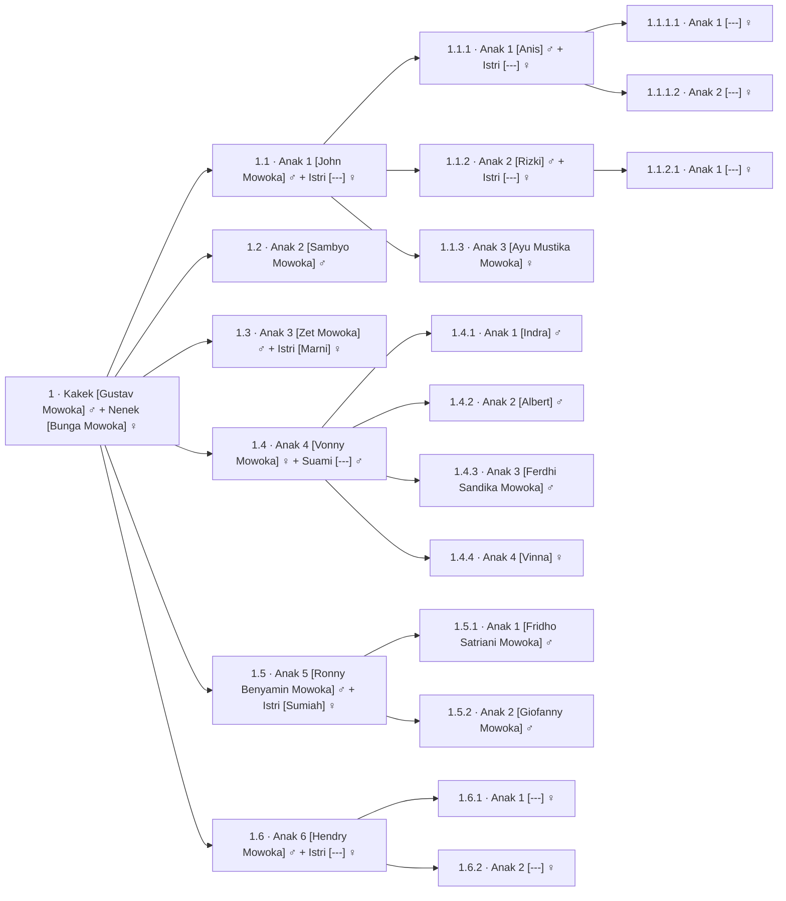

# Family Tree & Ahli Waris (Heir) Documentation

This project documents our big family's tree across four generations and keeps track of who the *ahli waris* (heirs) are. Everything lives in this one file so it is easy to read, update, and share among family members.

> ⚠️ **Privacy note:** Do not write NIK (national ID numbers), KK numbers, home addresses, phone numbers, or bank details in this file. Keep those in official documents (Kartu Keluarga, akta kelahiran, akta kematian, surat keterangan waris) stored safely offline.

---

## 1. Generations

| Generation | Indonesian term | Description |
|---|---|---|
| G1 | Kakek & Nenek | Grandfather and grandmother (root of the tree) |
| G2 | Anak | Their children |
| G3 | Cucu | Grandchildren (children of G2) |
| G4 | Cicit | Great-grandchildren (children of G3) |

---

## 2. ID System

Each person gets an ID that shows their line of descent, so you can trace anyone back to the grandparents just by reading the ID.

| ID | Meaning |
|---|---|
| `1` | Grandparents (G1) |
| `1.2` | 2nd child of the grandparents (G2) |
| `1.2.3` | 3rd child of child `1.2` (G3) |
| `1.2.3.1` | 1st child of grandchild `1.2.3` (G4) |

Spouses who married into the family use the same ID plus `-S` (for example `1.2-S` is the spouse of `1.2`). Children are numbered by birth order.

---

## 3. Family Tree Diagram

Generations flow left to right; siblings are stacked top to bottom. `---` means the name is not yet filled in.

---

## 4. Family Members Register

Status: **Hidup** (alive) or **Wafat** (deceased). Use the year only if the full date is not known.

### G1 — Kakek & Nenek

| ID | Name | Gender | Born | Status | Died | Notes |
|---|---|---|---|---|---|---|
| 1-K | Gustav Mowoka | M | YYYY | Hidup / Wafat | | |
| 1-N | Bunga Mowoka | F | YYYY | Hidup / Wafat | | |

### G2 — Anak

| ID | Name | Gender | Born | Status | Died | Spouse | Notes |
|---|---|---|---|---|---|---|---|
| 1.1 | John Mowoka | M | YYYY | | | --- (Istri) | |
| 1.2 | Sambyo Mowoka | M | YYYY | | | | |
| 1.3 | Zet Mowoka | M | YYYY | | | Marni (Istri) | |
| 1.4 | Vonny Mowoka | F | YYYY | | | --- (Suami) | |
| 1.5 | Ronny Benyamin Mowoka | M | YYYY | | | Sumiah (Istri) | |
| 1.6 | Hendry Mowoka | M | YYYY | | | --- (Istri) | |

### G3 — Cucu

| ID | Name | Gender | Parent ID | Born | Status | Died | Spouse | Notes |
|---|---|---|---|---|---|---|---|---|
| 1.1.1 | Anis | M | 1.1 | YYYY | | | --- (Istri) | |
| 1.1.2 | Rizki | M | 1.1 | YYYY | | | --- (Istri) | |
| 1.1.3 | Ayu Mustika Mowoka | F | 1.1 | YYYY | | | --- (Suami) | |
| 1.4.1 | Indra | M | 1.4 | YYYY | | | | |
| 1.4.2 | Albert | M | 1.4 | YYYY | | | | |
| 1.4.3 | Ferdhi Sandika Mowoka | M | 1.4 | YYYY | | | | |
| 1.4.4 | Vinna | F | 1.4 | YYYY | | | | |
| 1.5.1 | Fridho Satriani Mowoka | M | 1.5 | YYYY | | | | |
| 1.5.2 | Giofanny Mowoka | M | 1.5 | YYYY | | | | |
| 1.6.1 | --- | F | 1.6 | YYYY | | | | |
| 1.6.2 | --- | F | 1.6 | YYYY | | | | |

### G4 — Cicit

| ID | Name | Gender | Parent ID | Born | Status | Notes |
|---|---|---|---|---|---|---|
| 1.1.1.1 | [Name] | | 1.1.1 | YYYY | | |
| 1.1.2.1 | [Name] | | 1.1.2 | YYYY | | |
| 1.1.2.2 | [Name] | | 1.1.2 | YYYY | | |

---

## 5. Ahli Waris (Heir) Tracking

Inheritance is decided per person who has passed away (*pewaris*). Add one section for each pewaris. Who counts as an heir, and how much each receives, depends on which system the family uses:

- **Hukum Islam** (Kompilasi Hukum Islam / faraid), handled by the Pengadilan Agama
- **Hukum Perdata** (KUHPerdata / BW), handled by the Pengadilan Negeri
- **Hukum Adat** (customary law of the family's region)

Record which system applies, then list the heirs. The "Share" column should be filled in from the official decision or a notary / religious-court document, not guessed.

### Template (copy for each pewaris)

#### Pewaris: [Name] — ID [x]

| Field | Value |
|---|---|
| Date of death | YYYY-MM-DD |
| Inheritance law used | Islam / Perdata / Adat |
| Assets (general description only) | e.g. "house in [city]", "rice field" |
| Legal document | e.g. Surat Keterangan Waris / Penetapan Pengadilan No. … |
| Status | Belum dibagi / Dalam proses / Sudah dibagi |

| Heir ID | Name | Relationship to pewaris | Share | Status | Notes |
|---|---|---|---|---|---|
| | | Spouse / Child / Grandchild (pengganti) | | Received / Pending | |

**Note on *ahli waris pengganti* (substitute heirs):** if a child (G2) died before the grandparent, that child's children (G3) may inherit in their parent's place, depending on the law used. Mark them as "Grandchild (pengganti)" and add a note referencing the deceased parent's ID.

---

## 6. How to Update

1. When a baby is born, add a row in the right generation table with the next number under the parent's ID, then add a node in the Mermaid diagram.
2. When someone marries, fill in the Spouse column.
3. When someone passes away, change Status to **Wafat**, fill in the date, and create a new section under **Ahli Waris Tracking**.
4. Write a short entry in the change log below.

## 7. Change Log

| Date | Change | Updated by |
|---|---|---|
| YYYY-MM-DD | Initial family tree created | [Name] |

---

*This document is for family record-keeping only. It is not a legal document; for an official division of inheritance, consult a notary, the Pengadilan Agama, or the Pengadilan Negeri.*
